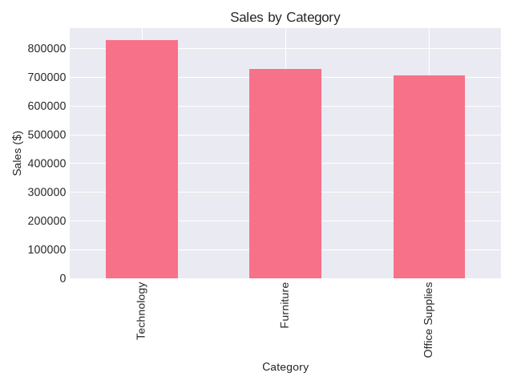

# Superstore Sales Analysis

Practical retail sales analysis focused on business decisions, not just charts.
I used Python and notebook workflows to identify where revenue is concentrated,
when demand rises and falls, and where teams should focus planning first.

## Executive Summary

This project analyzes four years of Superstore order data to answer the questions
a business team would actually ask:

- What is driving total revenue?
- Which customer groups matter most?
- When does demand typically rise or slow down?
- Where should operations and marketing focus first?

The result is a set of clean, reusable outputs in `data/processed/`, five
executable notebooks, a Tableau-ready dataset, and charts a manager can read
without running any code.

## Dataset

| Item | Details |
|---|---|
| Source | `data/raw/superstore.csv` (single canonical dataset) |
| Scope | 9,800 U.S. retail orders, Jan 2015 – Dec 2018 |
| Core fields | Order Date, Ship Date, Category, Sub-Category, Segment, Region, State, Sales |
| Outputs | Aggregated CSVs by category, segment, and month in `data/processed/` |

**Data note (worth knowing):** the source dates are **DD/MM/YYYY**
(e.g. `08/11/2017` = 8 Nov 2017). Every parser in this repo uses
`dayfirst=True`. Parsing them month-first silently scrambles monthly trends and
produces impossible shipping delays (negative values, 90+ day outliers) — an
earlier version of this project had exactly that bug, and the October 2026
cleanup fixed it everywhere: scripts, notebooks, processed CSVs, and charts.

**Scope note:** this export has no `Profit`, `Quantity`, or `Discount` column,
so this project claims sales and operations findings only. Profitability is a
stated next step (bring in the full Superstore export), not a finding.

## Key Metrics

- **Total sales analyzed:** **$2.26M** (4,922 orders, 793 customers, $459 average order value)
- **Sales mix by category:**
  - Technology: **$827K** (36.6%)
  - Furniture: **$729K** (32.2%)
  - Office Supplies: **$705K** (31.2%)
- **Sales mix by segment:**
  - Consumer: **$1.15M** (50.8%)
  - Corporate: **$688K** (30.4%)
  - Home Office: **$425K** (18.8%)
- **Sales by year:** 2015 $480K → 2016 $459K → 2017 $600K → 2018 $722K
- **Monthly seasonality:**
  - Highest month: **Nov 2018 ($117.9K)**
  - Lowest month: **Feb 2015 ($4.5K)**




## Key Findings

1. **Consumer drives most revenue.**
   Roughly half of all sales come from Consumer customers, which makes this
   segment the most direct lever for top-line impact.

2. **Revenue is fairly balanced across categories, with Technology leading.**
   Technology is first, but Furniture and Office Supplies are close enough that
   planning cannot rely on one category alone.

3. **Sales are seasonal, not flat — and growing.**
   Monthly results swing from $4.5K to $117.9K, and yearly totals rise from
   $480K (2015) to $722K (2018). Inventory and campaign timing should follow
   demand cycles instead of fixed monthly assumptions.

4. **Shipping performance is clean.**
   Delays run 0–7 days (mean 4.0, median 4). By mode (median): Same Day 0,
   First Class 2, Second Class 3, Standard Class 5 days. No relationship
   between order size and delay (Spearman −0.01, p = 0.16) — fulfillment speed
   is not quietly punishing large orders.


## Business Impact

- **Planning:** prioritize inventory around historically stronger months
  (notably Q4) instead of spreading stock evenly.
- **Commercial focus:** align promotions to the Consumer segment for broader
  reach while keeping targeted offers for Corporate accounts.
- **Performance tracking:** monitor category mix month over month to catch
  early shifts in demand.
- **Operational alignment:** use one recurring view to coordinate marketing,
  fulfillment, and purchasing decisions.

## Recommendations

- Build monthly planning targets by category and segment using the processed
  outputs as a baseline.
- Bring in the full Superstore export (with `Profit`) to add margin analysis
  by sub-category and region, so revenue growth is paired with margin protection.
- Explore the live Tableau dashboard (linked above); the build spec stays in `tableau/BUILD_GUIDE.md` for reference.
- Document a recurring review cadence so analysis supports ongoing decisions,
  not one-time reporting.

## How to Run

```bash
pip install -r requirements.txt

# Full printed analysis + headline charts
python analysis.py

# Regenerate the processed CSVs
python scripts/run_notebooks.py

# Regenerate shipping charts + summary
python scripts/run_shipping_analysis.py

# Notebooks (in order): 01 exploratory, 02 category, 03 monthly trends,
# shipping performance, then the full superstore_analysis walkthrough
jupyter notebook notebooks/
```

All notebooks execute end to end with saved outputs; every number in this
README matches the regenerated `data/processed/` files.

## Tableau Dashboard

The dashboard is live on Tableau Public: [**Superstore Data Viz**](https://public.tableau.com/app/profile/phil.greene/viz/SuperstoreDataViz_17947709580860/Sheet6) — KPI cards, category and
segment bars, monthly trend, and shipping delay by mode, with Year / Category /
Segment filters. Built from one tidy file
(`tableau/superstore_tableau.csv`, 9,800 rows) following the step-by-step spec in
[`tableau/BUILD_GUIDE.md`](tableau/BUILD_GUIDE.md).

## Repository Structure

```text
superstore-sales-analysis/
├── analysis.py                  # Full printed analysis + headline charts
├── README.md
├── requirements.txt
├── data/
│   ├── raw/superstore.csv       # Canonical dataset (9,800 rows)
│   └── processed/               # Monthly, category, segment aggregates
├── notebooks/                   # 5 executable notebooks with saved outputs
├── scripts/
│   ├── run_notebooks.py         # Regenerates data/processed/
│   ├── run_shipping_analysis.py # Shipping charts + visuals/summary.txt
│   ├── aggregate_sales_by_category.py
│   └── make_slides.py
├── docs/case_study.md
├── tableau/
│   ├── superstore_tableau.csv   # Tableau-ready tidy dataset
│   └── BUILD_GUIDE.md           # Dashboard build spec
└── visuals/                     # Charts, slide deck, shipping summary
```

## Tools Used

- Python (`pandas`, `matplotlib`, `seaborn`, `scipy`)
- Jupyter Notebooks (all re-executed with saved outputs)
- CSV exports for Excel-friendly review
- Tableau-ready dataset + build guide

## About Me

I am Phil Greene, an entry-level data analyst transitioning from operations, electrical, and customer-facing roles into analytics.

I am currently pursuing a BS in Data Analytics at SNHU, and I am building projects that show practical business thinking, clear communication, and reliable analysis workflows.

My background in independent e-commerce and operations work helps me frame analysis around real decisions, not just technical output.

## Connect

- LinkedIn: [Phil Greene](https://www.linkedin.com/in/philgreene89)
- X/Twitter: [@vtguy65](https://x.com/vtguy65)
- GitHub: [@WebCraftPhil](https://github.com/WebCraftPhil)

If you are hiring for a junior data analyst role, I would be glad to connect and share more of my work.
