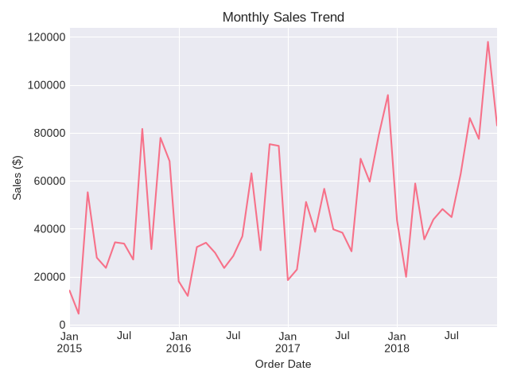
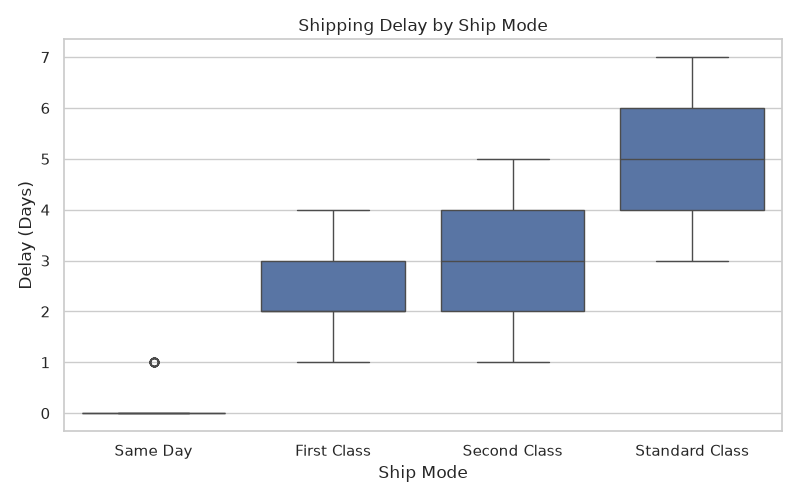

# Superstore Sales Analysis

**Where a $2.26M retailer makes its money, when it makes it, and where its growth is really coming from.**

[Live Tableau dashboard](https://public.tableau.com/app/profile/phil.greene/viz/SuperstoreDataViz_17947709580860/Sheet6) · [Case study](docs/case_study.md) · [Notebooks](notebooks/)

## TL;DR

- **Four months make the year.** September to December bring in **52%** of annual sales; January and February bring in just **7%**. Q4 alone is **38.5%**.
- **The biggest segment is the slowest-growing one.** Consumer is half of revenue, but grew only **+25%** from 2015 to 2018. Corporate grew **+85%** and Home Office **+77%**.
- **The business is growing.** Sales rose **50%** in four years ($480K in 2015 to $722K in 2018, about 15% a year), after a 4% dip in 2016.



## The business question

A retail team wants to plan next year's inventory, marketing and staffing. They need to know:

1. Which products, customers and regions drive revenue?
2. When does demand rise and fall?
3. Where is growth coming from, and is fulfillment keeping up?

## Data

| Item | Details |
|---|---|
| Source | `data/raw/superstore.csv` (Superstore sample retail dataset) |
| Scope | 9,800 order lines = 4,922 orders from 793 U.S. customers, Jan 2015 to Dec 2018 |
| Core fields | Order Date, Ship Date, Ship Mode, Segment, Region, State, Category, Sub-Category, Sales |
| Not included | Profit, Quantity, Discount (so this project makes no margin claims) |

**Data quality note:** the source dates are DD/MM/YYYY (`08/11/2017` is 8 Nov 2017). An earlier version of this project parsed them month-first, which silently scrambled the monthly trend and produced impossible shipping delays. I caught it, switched every parser to `dayfirst=True`, and regenerated every output.

## Approach

1. **Clean:** parse dates day-first, validate there are no missing or negative delays, compute shipping delay per order.
2. **Aggregate:** sales by category, sub-category, segment, region, state and month (outputs in `data/processed/`).
3. **Analyze:** year-over-year growth by segment and region, monthly seasonality, customer concentration, and shipping delay by mode (with a Spearman test for order total vs. delay).
4. **Communicate:** charts, two shipping summary slides (`visuals/slide_01.png`, `visuals/slide_02.png`, also as `visuals/slides.pdf`) and a live Tableau dashboard.

## Findings

1. **Demand is concentrated in the back half of the year.**
   Sep to Dec = 52% of sales; Nov alone is 15.5%. The peak month was Nov 2018 ($117.9K); the low was Feb 2015 ($4.5K).

2. **Growth is coming from business customers, not consumers.**
   Consumer is still the largest segment ($1.15M, 50.8%), but from 2015 to 2018 it grew +25%, while Corporate grew +85% and Home Office +77%.

3. **Revenue leans on a few places and product lines.**
   West and East = 61% of sales. California and New York alone = 33%. Phones and Chairs = 29%. The South is the smallest region (17%) and the slowest-growing (+18% since 2015).

4. **Customers come back.**
   98% of the 793 customers ordered more than once (median 6 orders). The top 20% of customers account for 48% of sales, so revenue is not dependent on a handful of big accounts.

5. **Shipping is reliable.**
   Every order shipped in 0 to 7 days (median 4). 60% of orders go Standard Class (median 5 days). Larger orders do not ship slower (Spearman correlation between order total and delay: -0.01, p = 0.36).




## Recommendations

1. **Plan the year around Sep to Dec.** Lock inventory and campaign calendars by August, since those four months carry over half of revenue.
2. **Build a business-customer offer.** Corporate and Home Office are growing three times faster than Consumer; a volume or account-based offer targets the fastest-growing revenue.
3. **Protect the core.** Phones and Chairs in California and New York are the largest single exposure; keep them in stock through Q4.
4. **Review the South before spending more there.** It is the smallest region and the slowest-growing.
5. **Add margin next.** Bring in the full Superstore export with Profit to confirm these sales wins are not margin losses.

## Tools and skills

- **Python:** pandas (cleaning, groupby aggregation, time series), matplotlib and seaborn (charts), scipy (Spearman test)
- **Jupyter:** five notebooks that run top to bottom with saved outputs
- **Excel-ready outputs:** every aggregate in `data/processed/` is a tidy CSV that opens straight into an Excel pivot table
- **Tableau Public:** KPI cards, category and segment bars, monthly trend, shipping by mode, with Year / Category / Segment filters
- **Data quality:** caught and fixed a date-parsing bug that distorted every time-based result

## How to run

```bash
pip install -r requirements.txt
python analysis.py                      # printed analysis + headline charts
python scripts/run_notebooks.py         # regenerates data/processed/
python scripts/run_shipping_analysis.py # shipping charts + visuals/summary.txt
jupyter notebook notebooks/             # open in order 01 to 05
```

## Repository structure

```text
superstore-sales-analysis/
├── analysis.py          # Full printed analysis + headline charts
├── data/
│   ├── raw/             # superstore.csv (9,800 rows)
│   └── processed/       # Category, segment and monthly aggregates
├── notebooks/           # 01 to 05, run in order
├── scripts/             # Regenerate outputs and charts
├── docs/case_study.md   # One-page case study
├── tableau/             # Tableau-ready dataset + build guide
└── visuals/             # Charts, slide deck, shipping summary
```

## About me

I'm Phil Greene, moving into data analytics from operations, electrical and e-commerce work. I'm working toward a BS in Data Analytics at SNHU, and I build projects around the decisions a business actually has to make.

[LinkedIn](https://www.linkedin.com/in/philgreene89) · [GitHub](https://github.com/WebCraftPhil) · [X](https://x.com/vtguy65)

Hiring for a junior data analyst? I'd be glad to talk.
